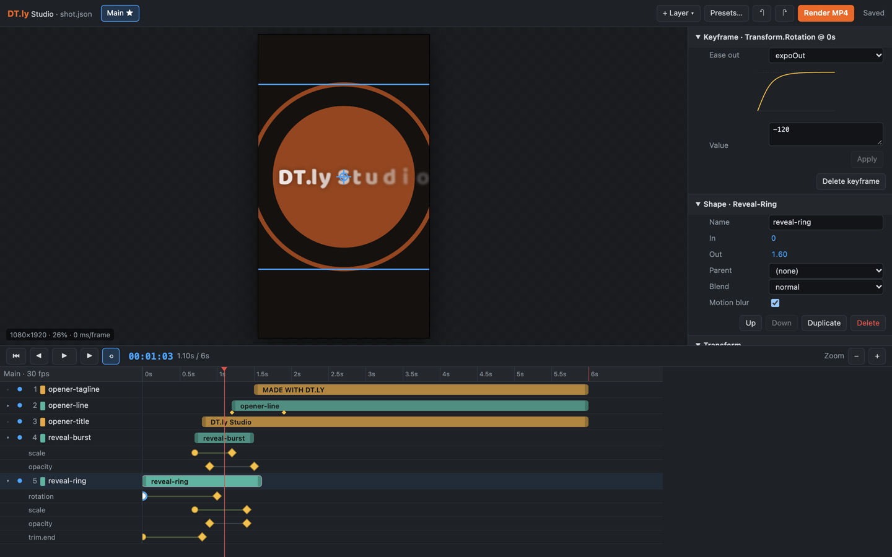

# DT.ly

[](https://www.npmjs.com/package/@dnyantra/dtly) [](LICENSE)

**After Effects-style motion graphics for code and AI agents.**
*From the creator of [CustomerPro.in](https://customerpro.in).*

DT.ly describes a video as plain JSON — compositions, layers, keyframes with easing curves,
text animators, masks, track mattes, trim paths, parenting, effects and motion blur — and renders
it to MP4. An MCP server lets AI agents edit projects keyframe by keyframe and look at the frames
they make.


- **Explainers & logos** — SVG import as editable shapes, curved paths, shape morphing, repeaters, stars, gradients, and Lottie animations as layers.
- **Infographics** — counters (with ₹ and lakh/crore formatting), bar, line, donut and progress charts.
- **App promos** — phone mockups with true-perspective 3D tilt, corner pin, cursor and tap overlays.
- **Stylised looks** — glitch, RGB split, wave, light leaks; glitch, RGB-whip, warp and flash transitions.
- **Colour grading** — curves, colour wheels, exposure, temperature, vignette, 3D LUTs (.cube) and adjustment layers.
- **Captions** — word-highlight captions from SRT/VTT or automatic transcription (Sarvam AI, Indian languages).
- **Maps** — animated routes from coordinates with pins, labels and distance, over a stitched map background.
- **Fine-grained animation** — any property can be keyframed with AE-style eases, bezier curves or physical springs; `wiggle` included.
- **Text animators** — per grapheme, word or line, with stagger, order, blur, tracking, colour and masked line reveals. Indian scripts (Devanagari etc.) keep their conjuncts while animating.
- **Presets** — kinetic typography, logo openers, colour-bar openers, slideshows with Ken Burns, push/whip/wipe/zoom transitions, lower thirds, highlight plates. Presets write ordinary layers, so everything stays editable.
- **Media** — video, image and audio layers, volume keyframes, music mixing.
- **Studio** — a browser preview and After Effects-style timeline editor that stays in sync with agents.
- **Agent-native** — 26 MCP tools plus **moti**, a skill that turns your agent into a motion designer.
- **No browser, no lock-in** — renders with skia-canvas and FFmpeg. MIT licensed.

## Install

Requires **Node.js 20+** and **FFmpeg** on your PATH (`brew install ffmpeg`, `sudo apt install ffmpeg`, or `winget install ffmpeg`).

```bash
npm install @dnyantra/dtly
```

Try it without installing:

```bash
npx @dnyantra/dtly init hello.json --starter kinetic --title "Hello"
npx @dnyantra/dtly render hello.json hello.mp4
```

### Use it from Claude Code

Install the plugin (MCP server + the **moti** skill) in one step:

```
/plugin install dtly --marketplace dnyantra/dtly
```

Or add the pieces yourself:

```bash
claude mcp add --scope user dtly -- npx -y @dnyantra/dtly mcp
npx @dnyantra/dtly skill install --agent claude
```

### Use it from Codex, Cursor, Gemini CLI, Copilot or Windsurf

The **moti** skill uses the open [Agent Skills](https://agentskills.io) format, so one command installs
it for every supported agent:

```bash
npx skills add dnyantra/dtly          # or: npx @dnyantra/dtly skill install --agent all
```

Then add the MCP server (the editing tools) to your agent:

| Agent | Setup |
|---|---|
| Codex | `codex mcp add dtly -- npx -y @dnyantra/dtly mcp` |
| Cursor | `~/.cursor/mcp.json` → `{"mcpServers": {"dtly": {"command": "npx", "args": ["-y", "@dnyantra/dtly", "mcp"]}}}` |
| Gemini CLI | `~/.gemini/settings.json` → same `mcpServers` block as Cursor |
| VS Code + Copilot | `.vscode/mcp.json` → `{"servers": {"dtly": {"type": "stdio", "command": "npx", "args": ["-y", "@dnyantra/dtly", "mcp"]}}}` |
| Windsurf | `~/.codeium/windsurf/mcp_config.json` → same `mcpServers` block as Cursor |

`npx @dnyantra/dtly setup <agent>` prints these steps for your agent. Agents without MCP can still use
DT.ly through the skill's CLI fallback (`init`, `still`, `sheet`, `render`).

Then ask for things like `/moti make a 10 second kinetic typography opener for my bakery` or
*"ease the call-to-action in with a spring and move it 0.3 s later"*.

## Studio — browser preview and timeline editor

```bash
npx @dnyantra/dtly studio project.json
```



- **Live preview** with the same renderer as the MP4 export, playback with audio, frame stepping.
- **Timeline**: drag layer bars to move them, drag the ends to trim, twirl open a layer to see every
  animated property, drag keyframes to retime them, double-click a property row to add a key.
  Everything snaps to frames and to the playhead.
- **Inspector**: After Effects-style stopwatches (⏱ animates a property, ◆ adds/removes a key at the
  playhead, ◀ ▶ jump between keys), scrubby numbers (drag sideways; Shift ×10, Alt ×0.1), colour
  pickers, text, an ease editor with curve preview (named eases, bezier, springs), raw JSON for the rest.
- **Viewer**: click to select the layer under the cursor, drag to move it (keyframes it if animated).
- **Undo/redo**, autosave to the project file, **Render MP4** with progress.
- **Live with agents**: edits an agent makes through MCP appear instantly; the agent can open the
  studio for you with the `studio_open` tool.

| Shortcut | Action |
|---|---|
| Space | Play / pause |
| ← / → (Shift: 10 frames) | Step one frame |
| Home / End | First / last frame |
| J / K | Previous / next keyframe of the selected layer |
| [ / ] | Move layer start to playhead / trim layer end at playhead |
| ⌘Z / ⇧⌘Z | Undo / redo |
| ⌘D | Duplicate layer |
| Delete | Delete selected keyframe (or layer) |
| ⌘/Ctrl + scroll, + / − | Zoom the timeline |

The studio listens on 127.0.0.1 only and its API needs a per-session token.

## Command line

After `npm install -g @dnyantra/dtly` (or via `npx @dnyantra/dtly …`):

```
dtly init <project.json> [--starter opener|kinetic|bars] [--title "Text"]
dtly render <project.json> <out.mp4> [--from s] [--to s] [--comp id] [--workers n]
dtly still  <project.json> <time> <out.png> [--scale 0.5]
dtly sheet  <project.json> <out.png> <t1,t2,...>
dtly import-svg <project.json> <file.svg> [--width 600] [--at x,y]
dtly captions <project.json> <audio|video|.srt|.vtt|.json> [--lang mr-IN]
dtly map-tiles <out.png> --tiles <url> --route "lat,lon;lat,lon" [--attribution "…"]
dtly studio <project.json> [--port 4400] [--no-open]
dtly presets
dtly mcp
dtly setup <claude|codex|cursor|gemini|copilot|windsurf>
dtly skill install [--agent claude|codex|cursor|gemini|copilot|all] [--project] [--dir path]
```

## Library

```ts
import {newProject, addLayer, setKeyframe, PRESETS} from '@dnyantra/dtly';
import {writeProject, renderVideo} from '@dnyantra/dtly/node';

const p = newProject({name: 'Promo', duration: 5, background: '#111'});
addLayer(p, 'main', {
  type: 'text', id: 'title', text: 'Fresh bread daily', size: 120, color: '#ffffff',
  animators: [{unit: 'word', stagger: 0.1, duration: 0.6, ease: 'backOut', from: {opacity: 0, y: 60}}],
});
setKeyframe(p, 'title', 'transform.scale', 0, [90, 90], {spring: {stiffness: 180, damping: 12}});
setKeyframe(p, 'title', 'transform.scale', 1, [100, 100]);
PRESETS['element.highlightWord'].apply(p, 'main', {layer: 'title', at: 1});

writeProject('promo.json', p);
await renderVideo('promo.json', 'promo.mp4');
```

Entry points: `@dnyantra/dtly` (model, edits, presets, renderer — browser-safe),
`@dnyantra/dtly/node` (MP4/PNG rendering, project files), `@dnyantra/dtly/mcp` (MCP server).
Installing the package also gives you the `dtly` command.

## The model

| After Effects | DT.ly |
|---|---|
| Composition / precomp | `comps[]`, layer `type: "precomp"` |
| Layer in/out | `inPoint`, `outPoint` (seconds) |
| Transform | `transform.anchor/position/scale(%)/rotation(°)/opacity(%)/skew` |
| Keyframes + easing | `{keyframes: [{t, v, ease}]}` — `easyEase`, `expoOut`, `backOut`, `[x1,y1,x2,y2]`, `{spring: {...}}`, `hold` |
| `wiggle()` | `{keyframes, wiggle: {freq, amp}}` |
| Parenting / null | `parent: id`, `type: "null"` |
| Masks / track mattes | `masks: [...]`, `matte: {layer, mode}` |
| Trim paths | shape `trim: {start, end}` |
| Text animators | `animators: [{unit, stagger, duration, ease, from: {...}, clip, mode}]` |
| Effects | `blur`, `dropShadow`, `glow`, `fill`, `brightness`, `saturate`, `contrast`, `tilt`, `cornerPin`, `rgbSplit`, `glitch`, `wave`, `curves`, `colorBalance`, `exposure`, `temperature`, `vignette`, `lut` |
| Adjustment layer | `type: "adjustment"` |
| Shape morphing / repeater | keyframe `path`; `repeater` |
| Footage (Lottie) | `type: "lottie"` |
| Motion blur | `motionBlur: {samples, shutter}` |

Layer index 0 is the top of the stack, as in After Effects. See
[`plugin/skills/moti/SKILL.md`](plugin/skills/moti/SKILL.md) for the full guide.

## Development

```bash
git clone https://github.com/dnyantra/dtly && cd dtly
npm install          # also builds dist/
npm test             # typecheck + end-to-end smoke test (renders + MCP round trip)
npm run test:studio  # drives the Studio in your installed Chrome (puppeteer-core)
npm run dev -- render examples/kinetic.json out.mp4
```

Opening Claude Code in the repo loads the local MCP server (`.mcp.json`) and the skill.

## Roadmap

- Studio: graph editor, drag-to-reorder layers, multi-select, media import by drag and drop
- Faster rendering: layer-bounds buffers, caching finished layers
- Templates with brand kits and media slots for fixed 30/60 s videos
- Templates with media slots; audio-reactive animation; beat-synced cuts

## License

MIT for the code. Bundled fonts (Baloo 2, Mukta) are under the SIL Open Font License 1.1.

---

DT.ly is made by the creator of [CustomerPro.in](https://customerpro.in) — WhatsApp marketing,
campaigns and AI agents for small businesses.
