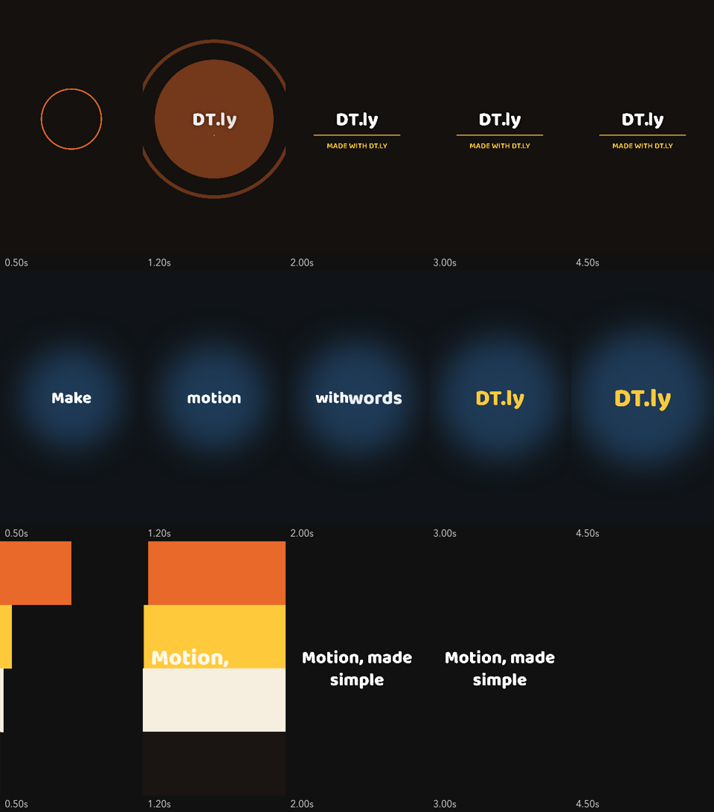

# DT.ly

[](https://www.npmjs.com/package/@dnyantra/dtly) [](LICENSE)

**After Effects-style motion graphics for code and AI agents.**
*From the creator of [CustomerPro.in](https://customerpro.in).*

DT.ly describes a video as plain JSON — compositions, layers, keyframes with easing curves,
text animators, masks, track mattes, trim paths, parenting, effects and motion blur — and renders
it to MP4. An MCP server lets AI agents edit projects keyframe by keyframe and look at the frames
they make.



- **Fine-grained animation** — any property can be keyframed with AE-style eases, bezier curves or physical springs; `wiggle` included.
- **Text animators** — per grapheme, word or line, with stagger, order, blur, tracking, colour and masked line reveals. Indian scripts (Devanagari etc.) keep their conjuncts while animating.
- **Presets** — kinetic typography, logo openers, colour-bar openers, slideshows with Ken Burns, push/whip/wipe/zoom transitions, lower thirds, highlight plates. Presets write ordinary layers, so everything stays editable.
- **Media** — video, image and audio layers, volume keyframes, music mixing.
- **Agent-native** — 21 MCP tools plus a skill that teaches motion-design rules.
- **No browser, no lock-in** — renders with skia-canvas and FFmpeg. MIT licensed.

## Install

Requires **Node.js 20+** and **FFmpeg** on your PATH (`brew install ffmpeg`, `sudo apt install ffmpeg`, or `winget install ffmpeg`).

```bash
npm install @dnyantra/dtly
```

Try it without installing:

```bash
npx @dnyantra/dtly init hello.json --starter kinetic --title "Hello"
npx @dnyantra/dtly render hello.json hello.mp4
```

### Use it from Claude Code

Install the plugin (MCP server + skill) in one step:

```
/plugin install dtly --marketplace dnyantra/dtly
```

Or add the pieces yourself:

```bash
claude mcp add --scope user dtly -- npx -y @dnyantra/dtly mcp
npx @dnyantra/dtly skill install
```

Then ask for things like *"make a 10 second kinetic typography opener for my bakery"* or
*"ease the call-to-action in with a spring and move it 0.3 s later"*.

## Command line

After `npm install -g @dnyantra/dtly` (or via `npx @dnyantra/dtly …`):

```
dtly init <project.json> [--starter opener|kinetic|bars] [--title "Text"]
dtly render <project.json> <out.mp4> [--from s] [--to s] [--comp id] [--workers n]
dtly still  <project.json> <time> <out.png> [--scale 0.5]
dtly sheet  <project.json> <out.png> <t1,t2,...>
dtly presets
dtly mcp
dtly skill install [--dir path]
```

## Library

```ts
import {newProject, addLayer, setKeyframe, PRESETS} from '@dnyantra/dtly';
import {writeProject, renderVideo} from '@dnyantra/dtly/node';

const p = newProject({name: 'Promo', duration: 5, background: '#111'});
addLayer(p, 'main', {
  type: 'text', id: 'title', text: 'Fresh bread daily', size: 120, color: '#ffffff',
  animators: [{unit: 'word', stagger: 0.1, duration: 0.6, ease: 'backOut', from: {opacity: 0, y: 60}}],
});
setKeyframe(p, 'title', 'transform.scale', 0, [90, 90], {spring: {stiffness: 180, damping: 12}});
setKeyframe(p, 'title', 'transform.scale', 1, [100, 100]);
PRESETS['element.highlightWord'].apply(p, 'main', {layer: 'title', at: 1});

writeProject('promo.json', p);
await renderVideo('promo.json', 'promo.mp4');
```

Entry points: `@dnyantra/dtly` (model, edits, presets, renderer — browser-safe),
`@dnyantra/dtly/node` (MP4/PNG rendering, project files), `@dnyantra/dtly/mcp` (MCP server).
Installing the package also gives you the `dtly` command.

## The model

| After Effects | DT.ly |
|---|---|
| Composition / precomp | `comps[]`, layer `type: "precomp"` |
| Layer in/out | `inPoint`, `outPoint` (seconds) |
| Transform | `transform.anchor/position/scale(%)/rotation(°)/opacity(%)/skew` |
| Keyframes + easing | `{keyframes: [{t, v, ease}]}` — `easyEase`, `expoOut`, `backOut`, `[x1,y1,x2,y2]`, `{spring: {...}}`, `hold` |
| `wiggle()` | `{keyframes, wiggle: {freq, amp}}` |
| Parenting / null | `parent: id`, `type: "null"` |
| Masks / track mattes | `masks: [...]`, `matte: {layer, mode}` |
| Trim paths | shape `trim: {start, end}` |
| Text animators | `animators: [{unit, stagger, duration, ease, from: {...}, clip, mode}]` |
| Effects | `blur`, `dropShadow`, `glow`, `fill`, `brightness`, `saturate`, `contrast` |
| Motion blur | `motionBlur: {samples, shutter}` |

Layer index 0 is the top of the stack, as in After Effects. See
[`plugin/skills/dtly/SKILL.md`](plugin/skills/dtly/SKILL.md) for the full guide.

## Development

```bash
git clone https://github.com/dnyantra/dtly && cd dtly
npm install          # also builds dist/
npm test             # typecheck + end-to-end smoke test (renders + MCP round trip)
npm run dev -- render examples/kinetic.json out.mp4
```

Opening Claude Code in the repo loads the local MCP server (`.mcp.json`) and the skill.

## Roadmap

- Browser preview and timeline editor on the same renderer
- Faster rendering: layer-bounds buffers, caching finished layers
- Templates with brand kits and media slots for fixed 30/60 s videos
- More AE features: 3D layers and camera, repeaters, path morphing, LUTs

## License

MIT for the code. Bundled fonts (Baloo 2, Mukta) are under the SIL Open Font License 1.1.

---

DT.ly is made by the creator of [CustomerPro.in](https://customerpro.in) — WhatsApp marketing,
campaigns and AI agents for small businesses.
